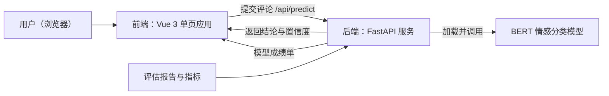
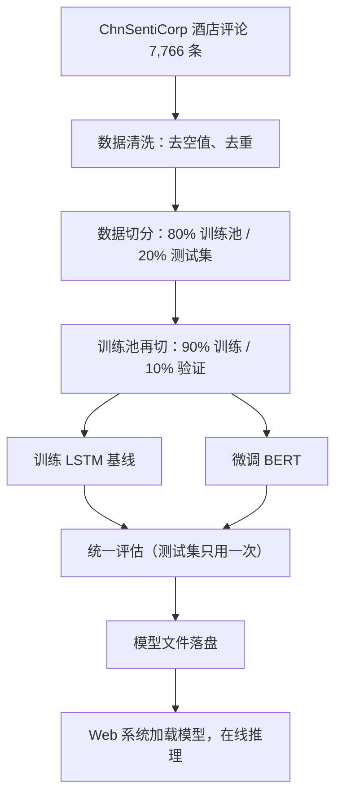

# 论文素材汇编

> 本文件是给 AI 助手看的素材库：指导项目主人把哪些内容放进论文哪一章。所有数字与 `model/reports/` 下的评估产物同源，引用时不需要重新计算。表格为 Markdown 格式，可直接改写进论文；图为 Mermaid 源码，渲染成图片后即可插入。

## 一、可直接引用的事实清单

- 任务：中文酒店评论情感二分类（好评 / 差评）
- 数据集：ChnSentiCorp 公开数据集的酒店评论子集，原始 7,766 条，清洗（去空值、去重）后 7,765 条；正负样本比约 69 : 31
- 数据切分：80% 训练池（6,212 条，内部再切 90% 训练 / 10% 验证）、20% 测试集（1,553 条）；测试集训练全程不接触，仅在最终评估使用一次；两个模型使用同一种子切分
- 模型一（基线）：字符级向量化 + 词嵌入 + 双向 LSTM（128 单元），训练 12 轮，按验证集准确率保存最优权重（第 5 轮，85.21%）
- 模型二（主模型）：bert-base-chinese 预训练模型微调，最大序列长度 128，训练 3 轮，warmup + 学习率线性衰减，按验证集准确率保存最优权重（第 3 轮，91.80%）
- 框架：TensorFlow 2.19（题目硬性要求）、transformers 4.57、Python 3.12，本机 Apple M4 训练（LSTM 约 10 分钟，BERT 约 31 分钟）
- 系统：Vue 3 前端 + FastAPI 后端，单服务部署；启动时加载模型进内存，仅推理不含训练逻辑

## 二、总体实验结果

| 模型 | 测试集准确率 | 负类精确率 | 负类召回率 | 正类精确率 | 正类召回率 |
|------|------------|-----------|-----------|-----------|-----------|
| LSTM（基线） | 83.90% | 76.0% | 71.4% | 87.2% | 89.7% |
| BERT（微调） | **90.47%** | 83.5% | 86.9% | 93.9% | 92.1% |

结论表述建议：在完全相同的数据切分与评估口径下，BERT 较 LSTM 基线高出 6.57 个百分点，且在少数类（差评）上的召回率高出 15.5 个百分点，说明预训练模型在理解上下文语义方面优势明显。

## 三、逐轮训练曲线（论文"实验过程"小节素材）

LSTM（修复后正式实验，12 轮）：

| 轮次 | 1 | 2 | 3 | 4 | 5 | 6~9 | 10~12 |
|---|---|---|---|---|---|---|---|
| 验证准确率 | 68.5% | 70.6% | 83.3% | 83.8% | **85.2%（峰值）** | 80~81% | 回落至 70.6% |

BERT 微调（3 轮）：

| 轮次 | 训练准确率 | 验证准确率 | 验证损失 |
|---|---|---|---|
| 1 | 84.9% | 91.2% | 0.211 |
| 2 | 93.3% | 91.5% | 0.194 |
| 3 | 97.0% | **91.8%（峰值）** | 0.235 |

可展开的实验叙事（体现真实工作量）：LSTM 首次训练曾欠训练（差评召回率仅 30.9%）；加大容量后学习率过大导致训练震荡；将学习率减半并引入按验证集保存最优权重的机制后达到 83.90%。BERT 首次微调在第 3 轮出现过拟合（验证损失反涨），改用 warmup 与线性衰减后解决。完整过程见 `docs/训练日志.md`。

## 四、图素材

### 1. 混淆矩阵（已生成，直接插入论文）

- `model/reports/confusion_matrix_lstm.png`
- `model/reports/confusion_matrix_bert.png`

对应数据：LSTM（负→负 349，负→正 140，正→负 110，正→正 954）；BERT（负→负 425，负→正 64，正→负 84，正→正 980）。

### 2. 系统架构图（Mermaid 源码，渲染后插入）

### 3. 技术流程图（Mermaid 源码，渲染后插入）

### 4. 需要主人自己补的系统截图（答辩 PPT 也用得上）

启动演示系统后（见 `AGENTS.md` 第四节），截取以下画面：

1. 首页全貌（输入框 + 示例按钮）
2. 输入转折句「房间很干净，但是服务态度太差，不会再来了。」的分析结果（应显示红色「差评」与置信度）
3. 一条普通好评的分析结果（绿色「好评」）
4. 历史记录区（有几条记录的状态）
5. 模型成绩单区（两模型准确率对比 + 混淆矩阵）

## 五、转折句演示表（"结合上下文理解转折"的实验证据）

| 评论 | LSTM 判定 | BERT 判定 | 正确答案 |
|---|---|---|---|
| 房间很干净，但是服务态度太差，不会再来了。 | 好评（85%，错） | 差评（2%，对） | 差评 |
| 位置有点偏，但性价比高，前台也很热情。 | 好评（85%，对） | 好评（100%，对） | 好评 |
| 早餐丰富，房间宽敞明亮，下次还住这家。 | 好评（85%，对） | 好评（100%，对） | 好评 |
| 服务很热情，可惜隔音太差，一晚上没睡好。 | 好评（84%，错） | 好评（100%，错） | 差评 |
| 离地铁站很近，房间却小得转不开身。 | 好评（60%，错） | 差评（5%，对） | 差评 |

## 六、章节与素材对应关系（常见本科论文结构，以学校模板为准）

| 论文章节 | 可用素材 |
|---|---|
| 第一章 绪论 | 一句话项目定位；情感分析的应用背景 |
| 第二章 相关技术 | TensorFlow、LSTM、BERT 与微调、Vue 3 与 FastAPI 的简述 |
| 第三章 需求分析与系统设计 | web/README.md 中的功能清单；系统架构图；技术流程图 |
| 第四章 系统实现 | 数据处理流程、两模型训练方案、Web 单服务部署方式 |
| 第五章 实验与结果分析 | 数据集事实清单、总体结果表、训练曲线、混淆矩阵、转折句演示表、失败案例 |
| 第六章 总结与展望 | 局限（见下）、展望（标准完整版数据集约 1.2 万条、RoBERTa 等更强预训练模型、多分类细粒度情感） |

## 七、表述口径注意（避免论文前后矛盾）

1. 测试集为本项目自定义切分（固定随机种子），论文中**不要**与公开文献报告的成绩直接对比，只做 LSTM 与 BERT 的内部对比。
2. 准确率目标：立项时曾自定 93% 作为冲刺参考线，但它不是题目要求；论文中若提及目标，建议表述为「以 LSTM 与 BERT 的模型对比来评估效果」。
3. 「枕头底下有个避孕套 → 误判好评」与「可惜隔音太差 → BERT 高置信度误判」两个失败案例，建议在第五章如实分析——主动讨论边界是加分项。
4. `docs/训练日志.md` 与根目录 `AGENTS.md` 是内部交接文档，内容不要直接搬进论文。
