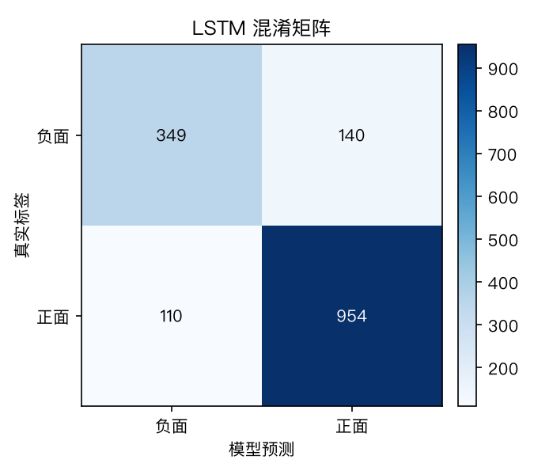
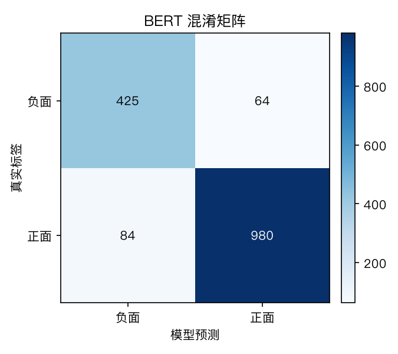

# 模型评估报告

数据集：ChnSentiCorp 酒店评论子集测试集（训练全程不接触）｜评估口径：LSTM 与 BERT 模型对比（准确率不设外部分数线）

## 一、总体对比

| 模型 | 测试集准确率 |
|------|------------|
| LSTM | 83.90% |
| BERT | 90.47% |

## LSTM 详细指标

```
              precision    recall  f1-score   support

          负面     0.7603    0.7137    0.7363       489
          正面     0.8720    0.8966    0.8842      1064

    accuracy                         0.8390      1553
   macro avg     0.8162    0.8052    0.8102      1553
weighted avg     0.8369    0.8390    0.8376      1553
```

## BERT 详细指标

```
              precision    recall  f1-score   support

          负面     0.8350    0.8691    0.8517       489
          正面     0.9387    0.9211    0.9298      1064

    accuracy                         0.9047      1553
   macro avg     0.8868    0.8951    0.8907      1553
weighted avg     0.9060    0.9047    0.9052      1553
```

## 转折句演示（题目硬性要求的检验）

| 评论 | LSTM 判定（正面概率） | BERT 判定（正面概率） |
|---|---|---|
| 房间很干净，但是服务态度太差，不会再来了。 | 好评（85%） | 差评（2%） |
| 位置有点偏，但性价比高，前台也很热情。 | 好评（85%） | 好评（100%） |
| 早餐丰富，房间宽敞明亮，下次还住这家。 | 好评（85%） | 好评（100%） |
| 服务很热情，可惜隔音太差，一晚上没睡好。 | 好评（84%） | 好评（100%） |
| 离地铁站很近，房间却小得转不开身。 | 好评（60%） | 差评（5%） |

## 混淆矩阵


